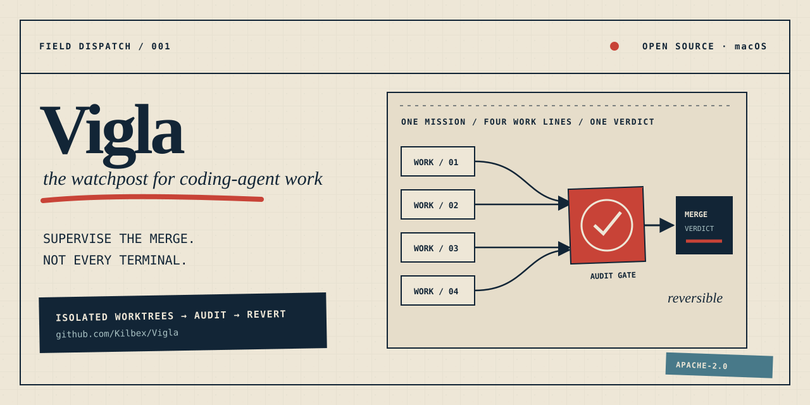
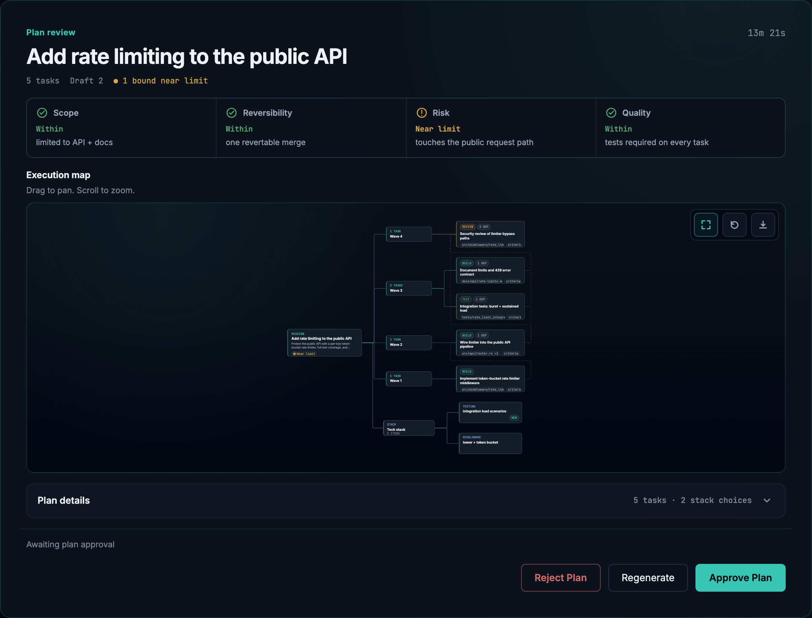
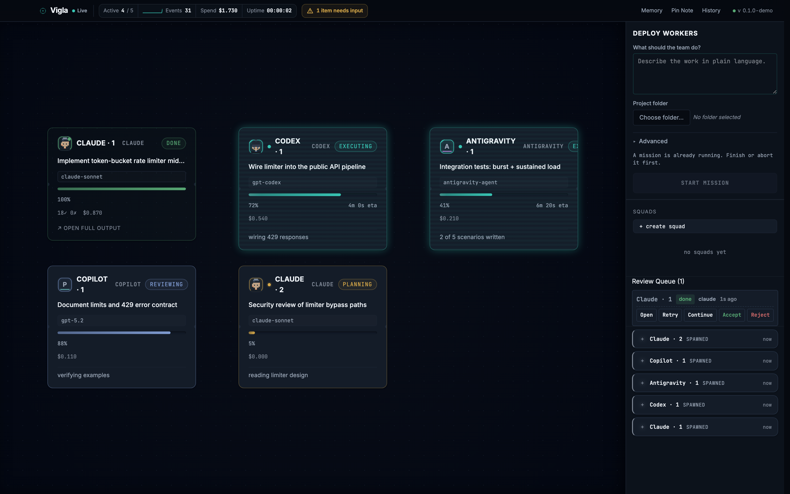
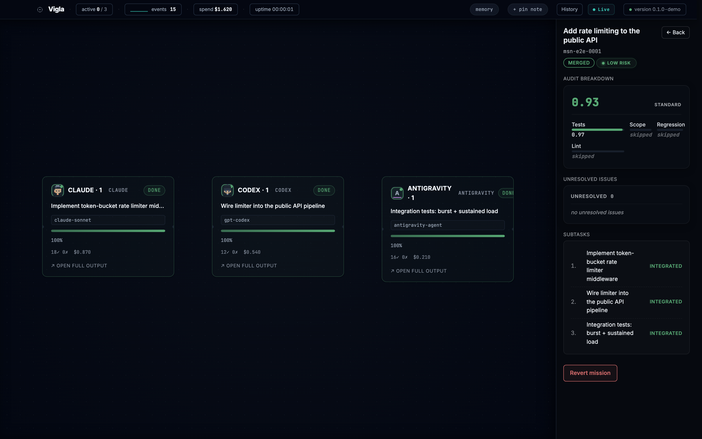

<p align="center">
  
</p>

<p align="center">
  <strong>Open-source mission control for coding agents.</strong><br />
  Run cross-vendor workers in parallel worktrees. Audit every submission.
  Revert the whole mission when the result is wrong.
</p>

<p align="center">
  <a href="https://kilbex.github.io/Vigla/demo/"><strong>Open the 16-second replay</strong></a>
  &nbsp;·&nbsp; <a href="https://kilbex.github.io/Vigla/">Field notes</a>
  &nbsp;·&nbsp; <a href="#build-a-local-dmg">Build on macOS</a>
  &nbsp;·&nbsp; <a href="./ARCHITECTURE.md">Read the architecture</a>
  &nbsp;·&nbsp; <a href="./CONTRIBUTING.md">Take an open task</a>
</p>

---

Five coding agents should not mean five terminals, five diff reviews, and five
unread merges. Vigla gives the work one operations room and gives you one job:
set the authority envelope, then judge the verdict.

| WORK | WATCH | VERDICT | REVERT |
|---|---|---|---|
| Claude Code, Codex CLI, Antigravity, and profile-backed CLIs share one mission | Each worker gets an isolated git worktree and typed event stream | A supervisor checks scope, reversibility, risk, and quality before merge | The accepted mission can be undone with a normal Git revert commit |

Vigla is local-first: a Rust orchestrator, Tauri shell, and SQLite event store,
with no cloud control plane, product account, or product telemetry. It
supervises the command-line tools you already use; it does not wrap model APIs
or add another billing layer.

> **Recovery receipt — 27/27.** Every seeded failure trajectory escalated
> within the default retry bounds. Reproduce the credential-free case set with
> `cargo xtask receipt`, then inspect the public
> [method, data, and limitations](./docs/evidence/recovery-receipt.md).

## Try the no-install replay

[Open the read-only browser replay](https://kilbex.github.io/Vigla/demo/) to
step through accepted, bound-tripped, and quota-paused missions in the real
Operations Room UI. The three event streams are hand-authored canonical
`event-schema` events committed in `app/src/demo/recordings.ts` — a scripted,
deterministic replay, not a capture of a real vendor session. The UI is the
production one; no account, vendor CLI, credential, or network-backed agent is
involved.

### Run the credential-free demo locally

Vigla ships a mock supervisor, so you can watch a whole mission —
decomposition, parallel workers, integration, audit, verdict — with no vendor
CLI, no credentials, and no token spend:

```sh
git clone https://github.com/Kilbex/Vigla.git && cd Vigla
pnpm install --frozen-lockfile
./scripts/dev.sh
```

When the Operations Room window opens:

1. In the **DEPLOY WORKERS** panel, describe the work under *What should the
   team do?*
2. Click **Choose folder…** and pick a Git repository.
3. Expand **Advanced**.
4. Set the **Supervisor** dropdown to **Mock (demo)** — the only other choice
   is **Claude**.
5. Click **Start mission**. A notice above the button confirms the mock is
   armed.

The choice is sticky per machine and defaults to **Claude**, so the demo is
opt-in and nobody gets it by accident.

**The mock mission is not a dry run.** It spends nothing and reads no
credential — no vendor CLI process is launched and no API key or login is
read — but it drives the real mission machinery against the folder you chose:
it creates a supervisor branch and worktree, a branch and worktree per worker,
writes files, and makes real `git commit`s, then integrates each worker's work
and stops at a pending-merge decision you **Merge** or **Discard** from the
mission overlay. (The review queue is a different surface: it triages
individual worker submissions, not the mission verdict.) Point it at a scratch
repository or a branch you don't mind.

It shows the happy-path arc only. Every task takes a clean first pass by
construction, so a mock mission can never produce a blocked, failed,
retry-exhausted, or quota-exhausted trajectory, and Plan mode *Review* has no
effect on it — the mock runtime never pauses for plan approval. The unhappy
paths live in two other places:

- the [browser replay](https://kilbex.github.io/Vigla/demo/), which scripts
  accepted, bound-tripped, and quota-paused missions;
- the seven bundled mock-harness scripts — `claude_happy`, `codex_blocked`,
  `gemini_happy`, `gemini_blocked`, `gemini_failed`, `gemini_terminal`,
  `claude_quota_exhausted` — each of which drives a single **worker**, not a
  mission. Run `mock-harness --help` for the trajectory each one takes, or
  spawn them from **Settings → Developer → Mock spawn** in a development build
  (`import.meta.env.DEV`, or `VITE_VIGLA_E2E=1`).

Prereqs: macOS 12+, [Rust 1.95](./rust-toolchain.toml) via rustup,
Node 22, pnpm 10, Xcode Command Line Tools. See
[CONTRIBUTING.md](./CONTRIBUTING.md#fast-start) for the full setup.

## How it works

**1 — Assign a mission inside an envelope.** Describe the goal, choose
the worker roster and models, and set the authority envelope. In review
mode the supervisor proposes a plan first — task graph, file scope, risk
fit — and waits for your approval:

<div align="center">



</div>

**2 — The supervisor arbitrates; you stay out of the loop.** Workers
execute in parallel worktrees while the supervisor reviews each
submission and decides **Accept / Extend / Scrub / Escalate** — inside
your envelope, without pinging you. Live state, diffs, tests, cost, and
raw terminals are always one click away if you *want* to watch.

<div align="center">



</div>

**3 — You judge results, not keystrokes.** Finished missions land in
your inbox with a structured verdict: audit score, test results, files
changed, residual-risk band, unresolved issues — and a revert button
that undoes the whole mission atomically:

<div align="center">



</div>

The vocabulary is small and precise — *mission*, *worker*, *envelope*,
*arbiter*, *verdict* — and defined in [docs/lexicon.md](./docs/lexicon.md).

## How it compares

The table is positioning, not a feature checklist. Each cell is backed
by a primary source below; cells are re-verified before each release.

*Sources verified 2026-07-21.* “Not documented” means the linked product
documentation does not describe that capability; it is not a claim that an
internal implementation is impossible.

| | Vigla | Codex app (OpenAI) | Claude Code on desktop (Anthropic) |
|---|---|---|---|
| Cross-vendor worker roster | yes | no; Codex agents | no; Claude agents |
| Parallel local agent sessions | yes | yes | yes |
| Isolated git worktrees | one per worker | built in | automatic or manual |
| Bound-based supervisor audit across workers | yes | not documented | not documented |
| Atomic mission merge + revert | yes | not documented | not documented |
| Deterministic demo without a vendor account | yes | not documented | not documented |

<details>
<summary><b>Sources</b></summary>

- **Vigla.** See this README and [ARCHITECTURE.md](./ARCHITECTURE.md) for positioning
  and goals; [LICENSE](./LICENSE) (Apache 2.0).
- **Codex app (OpenAI).**
  [Introducing the Codex app](https://openai.com/index/introducing-the-codex-app/)
  documents parallel agents, local and cloud work, and built-in worktree
  support.
- **Claude Code on desktop (Anthropic).**
  [Claude Code on desktop](https://code.claude.com/docs/en/desktop)
  documents parallel sessions and automatic worktree isolation; the
  [worktrees guide](https://code.claude.com/docs/en/worktrees) covers the
  underlying isolation flow.

</details>

## Vendor support

Real workers are driven from the in-app Deploy panel; the mock harness
covers demos and CI. Two independent tiers of evidence back a vendor, and
they are not interchangeable:

- **Adapter goldens (CI).** Committed transcript-and-golden pairs run through
  the shared `vigla-adapter-conformance` harness on every pull request. They
  pin the byte-to-event contract. They prove nothing about the vendor binary.
- **Real-CLI gate (local, opt-in).** An `#[ignore]`d integration test that
  spawns the actual CLI against a failing fixture repository and asserts the
  agent fixed the defect. It needs a working binary and credentials, so **no
  CI workflow runs it** — a maintainer runs it by hand.

| Vendor | Binary | Role | Real-CLI gate (local, opt-in) | Adapter goldens (CI) |
|---|---|---|---|---|
| Claude Code | `claude` | supervisor + worker; session retry / continue | `real_claude_gate.rs`, `supervisor_live.rs` | 6 conformance cases + `from_fixture.rs` |
| Codex CLI | `codex` | worker | `real_codex_run.rs`, `supervisor_live.rs` | 4 conformance cases + `from_fixture.rs` |
| Antigravity | `agy` | profile-backed worker | `real_antigravity_run.rs` | 4 conformance cases |
| Gemini CLI | `gemini` | legacy / enterprise worker | `supervisor_live.rs` | 4 conformance cases + `from_fixture.rs` |
| Kiro | `kiro-cli` | profile-backed worker | none yet | 4 conformance cases |
| GitHub Copilot | `copilot` | profile-backed worker | none yet | 4 conformance cases |

Google ended consumer **Login with Google** access for Gemini CLI on
2026-06-18. Vigla retains the adapter for existing enterprise and legacy
configurations, but Gemini CLI is no longer a primary launch path. Google
directs affected consumer users to Antigravity in its
[official deprecation notice](https://developers.google.com/gemini-code-assist/docs/deprecations/code-assist-individuals).

**Mission supervision is Claude-only today.** The Supervisor dropdown offers
exactly two values — *Claude* (spawns the real `claude` CLI) and *Mock (demo)*
(the scripted runtime, no vendor process) — and `host_services` rejects any
other `supervisor_model` with `UnsupportedSupervisorModel`. There is no
experimental non-Claude supervisor to opt into; a second *real* supervisor is
[roadmap work](./ROADMAP.md). Vigla does not pin vendor CLI versions — the
launch path verifies each configured binary, and the real-CLI gates track
adapter compatibility:

```sh
cargo test -p vigla-orchestrator --test real_claude_gate -- --ignored --nocapture
cargo test -p vigla-orchestrator --test real_codex_run   -- --ignored --nocapture
cargo test -p vigla-orchestrator --test real_antigravity_run -- --ignored --nocapture --test-threads=1
VIGLA_LIVE=1 cargo test -p vigla-orchestrator --test supervisor_live -- --ignored --nocapture
```

`VIGLA_LIVE=1` is not optional on the last line: without it every test in
`supervisor_live.rs` prints a skip line and passes, so the gate looks green
without having run.

The Claude and Codex gates use `tests/samples/sandbox/`, a workspace-excluded
crate with a deliberately wrong `multiply` function. The Antigravity gate
creates the same kind of isolated failing Rust fixture in a temporary
repository. Each of those three asserts that the agent fixed the defect. The
supervisor gate builds its own throwaway repositories instead — a wrong `add`,
a broken test, and a docs task — and asserts that a real `claude` supervisor
drives each mission to a completed, audited verdict.

## Feature tour

<details>
<summary><b>Mission launch and supervision</b></summary>

- **Deploy panel** — supervisor profile, worker vendor roster, worker
  count, model selections, plan mode, objective, folder, and optional
  scoped paths.
- **Plan governance** — direct mode, or review-first mode showing the
  generated plan, task graph, worker assignments, file scope, and
  envelope checks with approve / regenerate / abort.
- **Arbiter-driven supervision** — one supervisor per mission decides
  Accept / Extend / Scrub / Escalate without pausing inside the
  envelope.
- **Structured completion verdicts** — `CompletionVerdict` scores test
  pass, scope, regression, and lint into a residual-risk band
  (Low / Medium / High) with the full audit breakdown in the inbox.
- **Reversibility envelope** — task integrations and the final target merge
  receive distinct rollback anchors; `Revert mission` preserves later commits.
- **Inspectable aborts** — abort retains Vigla-owned branches and worktrees for
  diagnosis; the explicit `Clean up artifacts` action removes them later without
  changing the target branch.

</details>

<details>
<summary><b>Worker execution</b></summary>

- **Real CLI and mock workers** — Claude Code, Codex CLI, Antigravity,
  legacy Gemini CLI, profile-backed Kiro / Copilot, plus deterministic mock
  workers for development and demos.
- **Isolated worktrees** — each worker gets its own git worktree and
  branch; work is inspected, merged, discarded, or reverted without
  touching your main checkout.
- **Canonical event stream** — adapter-normalized status, cost, file,
  test, review, and terminal events (`event-schema`).
- **Session-aware recovery** — Claude workers support retry and
  follow-up continuation; quota windows can pause missions and resume
  them when the window reopens; failures are classified for retry,
  continuation, or escalation.

</details>

<details>
<summary><b>Operations room</b></summary>

- **Station canvas** — one tile per worker with dependency edges, live
  status, task, model, progress, ETA, cost, file and test counters.
- **Worker drawer** — result, feed, terminal, files, tests, cost, and
  plan tabs; stop, retry / continue, switch models, assign squads.
- **Review queue** — workers needing review surface as actionable cards
  with open, retry, continue, accept, and reject flows.
- **Live terminal capture** — raw stdout/stderr preserved alongside
  normalized events; a power-user feed with every event is one toggle
  away.
- **Squads** — group workers, designate leads, color-code the fleet.

</details>

<details>
<summary><b>Inbox, history, and replay</b></summary>

- **Mission inbox** — completions, escalations, side effects,
  unresolved issues, audit breakdowns, and revert eligibility in one
  right rail; macOS notifications when a bound trips while the app is
  unfocused.
- **Mission history** — browse audited missions with status, risk
  tier, and full drill-down.
- **Worker replay** — page through event history, play / pause, step,
  scrub, change speed, and return to live.

</details>

<details>
<summary><b>Memory and context</b></summary>

- **Local Memory Kernel** — repository-scoped memory written through a
  single-writer path and attached to future workers as context bundles.
- **Pinned notes + auto-promoted insights** — pin facts, decisions, and
  hazards; completed work proposes durable notes after validation.
- **Safety filters** — memory writes are size-limited, schema-checked,
  secret-scanned, and drift-checked.
- **Vendor-native files as render targets** — `CLAUDE.md`, `AGENTS.md`,
  and `GEMINI.md` are generated projections, never the source of truth.

</details>

## Built in public

| Now | Next | Later |
|---|---|---|
| Harden real-CLI gates, local packaging, first run, and regression coverage | Verify more adapters and supervisors; prove [Mac App Store sandbox feasibility](./docs/roadmap/mac-app-store.md) | Add Linux and Windows parity, richer memory provenance, reusable missions, and a public fleet benchmark |

Priorities move with operator evidence and focused contributions. See the
[full roadmap](./ROADMAP.md) for acceptance boundaries and the work Vigla
deliberately will not take on.

## Tech stack

| Layer | Choice |
|---|---|
| Desktop shell | Tauri 2 (Rust host) |
| Orchestrator | Rust 1.95, `tokio`, `sqlx` (SQLite), `tracing` |
| UI | React 19, Vite, TypeScript, Tailwind v4, Zustand |
| Canvas & terminal | React Flow (`@xyflow/react`), xterm.js |
| IPC | `tauri-specta` typed bindings (Rust → TS) |
| Tests | cargo test, Vitest, Playwright |

The only abstraction Vigla permits is the event boundary: vendor CLI
bytes → canonical events. Adapters live in `crates/adapters/{vendor}`, one
crate per vendor, pure translation — no I/O, no process spawning, no
git.

<details>
<summary><b>Storage paths</b></summary>

| Path | What | Override |
|---|---|---|
| `~/Library/Application Support/Vigla/vigla.sqlite` | Worker events, missions, workers, audit summaries, quota state | `VIGLA_DB_PATH` |
| `<repo>/.vigla/memory/memory.sqlite` | Memory index (notes, witnesses, bundles), one store per repo | rooted at the repo's canonical git root, not under `VIGLA_DB_PATH` |
| `<repo>/.vigla/memory/notes/` | Long-term memory note bodies (Markdown), alongside the index | same repo root |
| `~/Library/Logs/Vigla/vigla.log.YYYY-MM-DD` | Rolling daily structured logs | managed by `tracing-appender` |

The desktop app is macOS-only, so those are the paths you will actually
see. The orchestrator crate is portable and resolves the database
against the host platform's own convention, which is what the Linux CI
job exercises: `$XDG_DATA_HOME/vigla/vigla.sqlite` (default
`~/.local/share/vigla/vigla.sqlite`) on Linux, and
`%APPDATA%\Vigla\vigla.sqlite` on Windows. `VIGLA_DB_PATH` overrides
all of them.

</details>

<details>
<summary><b>Repo layout</b></summary>

```
vigla/
├── app/                  # Tauri 2 + React 19 + Vite + TS
│   ├── src/              # React UI, Zustand stores, hotkeys
│   └── src-tauri/        # Tauri host (Rust): IPC, event forwarding
├── crates/               # All Rust library/bin crates (Cargo workspace)
│   ├── orchestrator/     # Rust supervision crate (business logic)
│   │   ├── src/memory/               # Memory Kernel (event-sourced)
│   │   ├── src/mission_runtime/      # Mission state machine + replay
│   │   ├── src/mission_supervisor_run/ # Supervisor turns + review loop
│   │   ├── src/supervisor/           # Worker process lifecycle + resume
│   │   ├── src/arbiter/              # Bound-based escalation decisions
│   │   └── resources/                # Bundled at compile time:
│   │       ├── vendor_profiles/      #   per-vendor command-rendering policy
│   │       └── skills/               #   worker skill set (embedded)
│   ├── adapters/         # One pure crate per vendor CLI + supervisor
│   ├── event-schema/     # Canonical typed event contract
│   ├── mock-harness/     # Mock vendor CLI (credential-free demos)
│   └── xtask/            # Workspace task runner (cargo xtask)
├── tests/                # Playwright e2e specs + real-CLI sample targets
├── docs/                 # Lexicon, good-first-issues, media
└── scripts/              # dev.sh, build.sh, capture-readme-media.cjs
```

</details>

Deep dive: [ARCHITECTURE.md](./ARCHITECTURE.md) covers the orchestrator,
memory kernel, mission lifecycle, arbiter / audit / recovery, event
schema, and per-vendor adapters.

## Requirements

- **macOS 12+.** Linux and Windows are on the [roadmap](./ROADMAP.md) —
  the non-host Rust workspace is built, linted, and tested on Linux in CI;
  desktop packaging and platform UX are scoped on the roadmap.
- Development: Rust 1.95 (pinned via `rust-toolchain.toml`), Node 22.x,
  pnpm 10.x, Xcode Command Line Tools.
- Vendor CLIs are optional and only needed for real (non-mock) workers.

## Build a local DMG

Vigla publishes no maintainer-built binaries today: there is no signing
identity, notarization credential, or update channel to trust, and the only
supported artifact is the one your machine produces. (A Mac App Store release
would replace that trust model with Apple's; whether to make that trade is
[undecided and under investigation](./docs/roadmap/mac-app-store.md).) On a
Mac, clone the source and run one command:

```sh
./scripts/build.sh
```

The script installs the locked frontend dependencies, builds the application,
ad-hoc signs it without an Apple account or personal signing identity, verifies
the app and disk image, and prints the DMG path and SHA-256 checksum. The local
artifact remains under `target/release/bundle/dmg/`; no workflow uploads it.

Keep the printed checksum with the artifact. [SECURITY.md](./SECURITY.md#verifying-a-local-build)
documents the independent `shasum`, `hdiutil`, and `codesign` checks.

Prerequisites are the development tools listed in [Requirements](#requirements).
Set `EMBEDDINGS=1` when running the command to include the optional embeddings
feature. Its first use downloads the public FastEmbed model into the per-user
cache; if that download is unavailable, retrieval falls back to local BM25.

## Known limitations

Design trade-offs in the current build, not bugs:

- **Real supervisor execution is Claude-only.** `supervisor_model` accepts
  `claude` (the real CLI) or `auto` (the scripted mock); everything else is
  rejected. Cross-vendor applies to workers, not to the supervisor.
- **Memory retrieval is local and best-effort.** Alias-expanded BM25
  with optional embedding / hybrid re-ranking; degrades to lexical
  retrieval instead of blocking workers.
- **The supervisor sees typed mission events, not raw worker
  dialogue.** By design — escalation is bounded on outcomes, not
  chain-of-thought.
- **Session resume requires vendor session-ID support.** CLIs that
  don't expose a session ID can't be continued across app restarts.

## Why "Vigla"?

**Vigla** (Byzantine Greek *βίγλα*, "watchpost" — from Latin *vigilia*,
the root of *vigilance*) was the imperial guard regiment that kept the
night watch on campaign: it posted the sentries, held the watchword,
and ran the signal line so the emperor could actually sleep. That is
this app's entire job — a supervisor that keeps trained watch over a
fleet of powerful agents and wakes you only when something crosses a
bound.

In category terms: Vigla is an open-source control plane for supervised
agent operations — coordinating fleets of AI coding agents instead of
babysitting them one terminal at a time.

## Contributing

Start with [CONTRIBUTING.md](./CONTRIBUTING.md) and
[ARCHITECTURE.md](./ARCHITECTURE.md); project authority and maintainer
succession are explicit in [GOVERNANCE.md](./GOVERNANCE.md).
Newcomer-friendly tasks live in
[docs/GOOD_FIRST_ISSUES.md](./docs/GOOD_FIRST_ISSUES.md) — adapter
fixture work is the recommended first PR and is designed to land in
under two hours.

Questions and bug-report routing: [SUPPORT.md](./SUPPORT.md). Security reports:
see [SECURITY.md](./SECURITY.md). Reviewing or recording Vigla? The public
[creator kit](./docs/operations/creator-kit.md) provides a 10-minute script,
credential-free inputs, media, evidence, and exact claim boundaries.
Operators coming from vibe-kanban can use the
[concept-by-concept migration guide](./docs/migrations/from-vibe-kanban.md);
it does not claim a database importer or kanban-board parity.

## License

[Apache 2.0](./LICENSE), with the project [NOTICE](./NOTICE). Bundled component
attribution and retained licenses are in
[THIRD_PARTY_NOTICES.md](./THIRD_PARTY_NOTICES.md); the generated,
self-contained [THIRD_PARTY_NOTICES.txt](./THIRD_PARTY_NOTICES.txt) covers the
locked production Rust and JavaScript dependency graphs.

---

<div align="center">

If Vigla looks useful, **a ⭐ helps other agent operators find it.**

</div>
